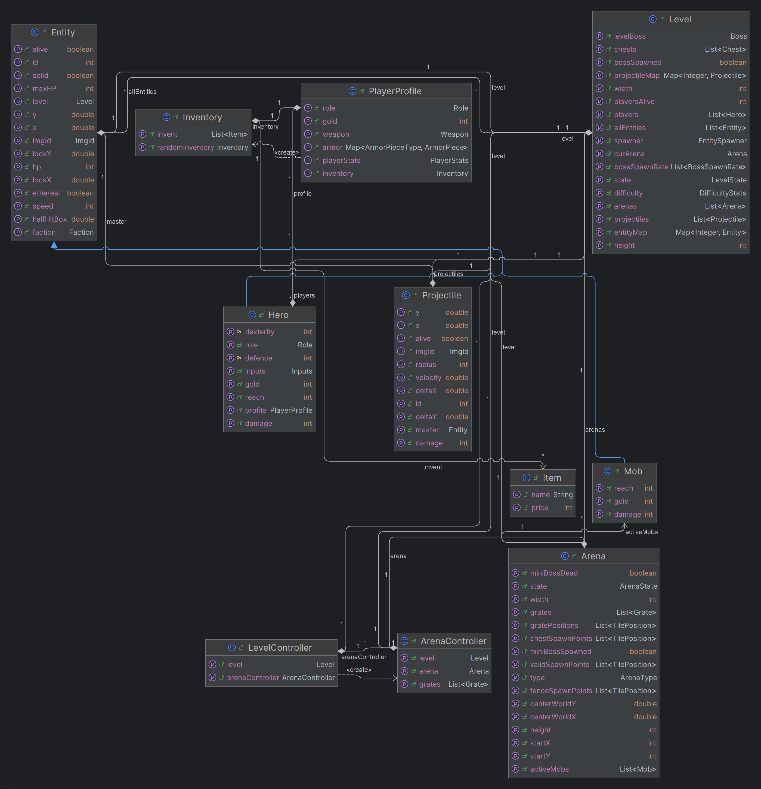
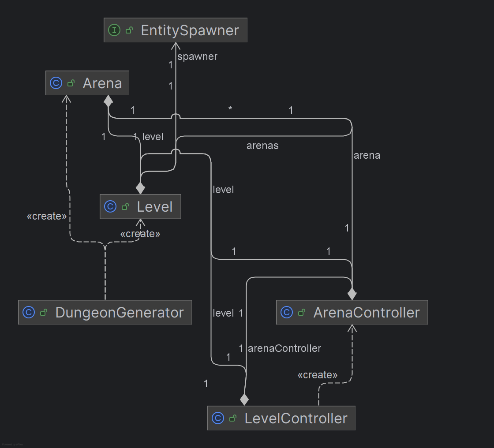
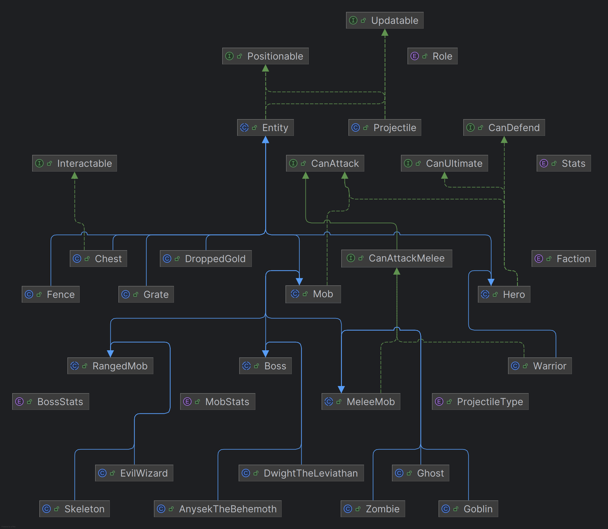
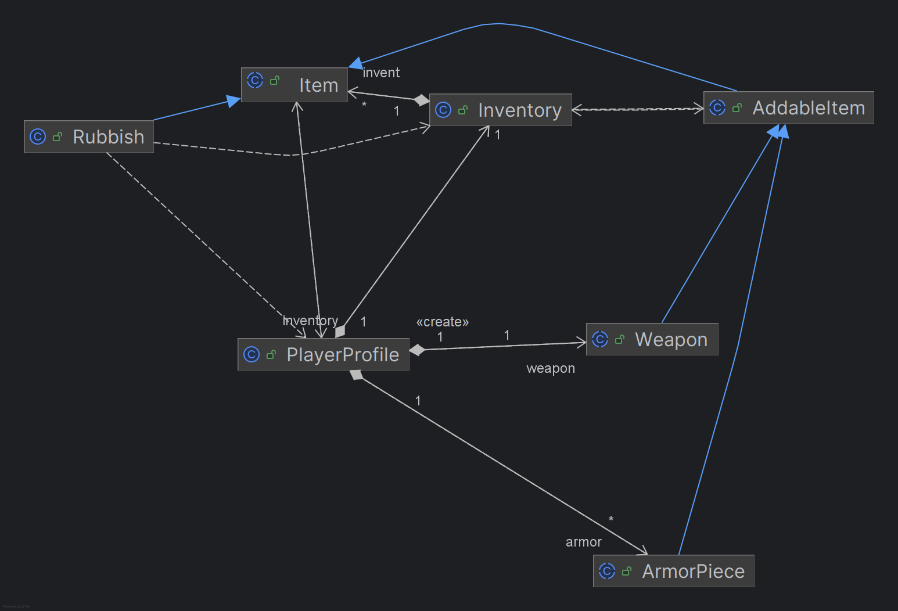
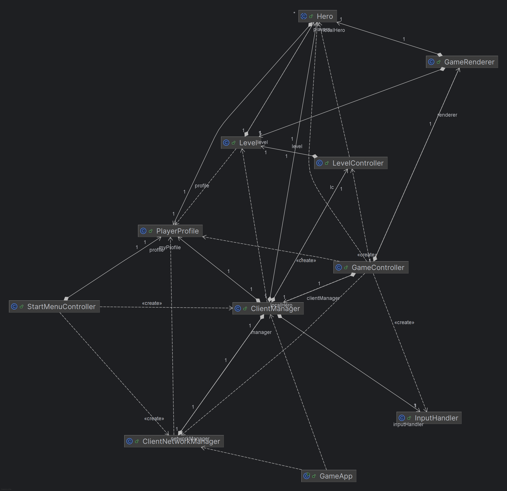
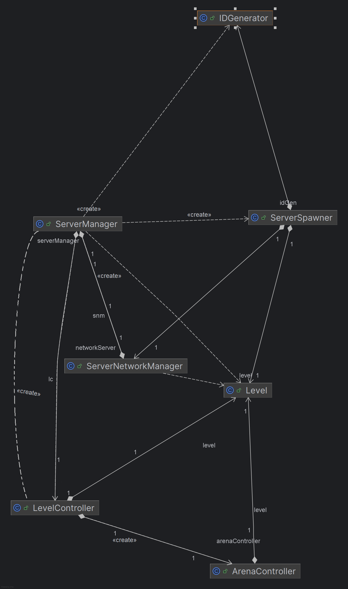

# Dungeon Master Architecture

Dungeon Master is a JavaFX dungeon crawler with a client/server-style runtime. Even when the player hosts locally, the game is split into two main parts:

- **Server side**: owns the real game state, level simulation, spawning, collisions, arena progression, and victory/game-over decisions.
- **Client side**: owns JavaFX screens, input capture, rendering, inventory UI, and a local synchronized copy of the level.
- **Network layer**: sends player input to the server and sends authoritative updates back to clients.

## Main Packages

### `cz.fel.cvut.pjv.dgnmstr`

Application startup.

- `DungeonMasterLauncher` starts the JavaFX application.
- `GameApp` loads fonts, configures logging, initializes scenes, and cleans up server/client threads on shutdown.

### `global`

Runtime coordination.

- `GameManager` stores references to active managers, controllers, renderer, and input handler.
- `ServerManager` creates the authoritative level, starts the server update loop, applies inputs, and triggers network updates.
- `ClientManager` maintains the client-side level copy, handles incoming packets, sends inputs, and sends profile changes.
- `InputHandler` converts JavaFX keyboard/mouse events into `Inputs`.
### `view`

JavaFX UI and rendering.

- `SceneManager` loads and switches FXML views.
- `StartMenuController` handles loading profiles, hosting, connecting, saving, and starting the game.
- `GameController` starts rendering/input once the client has a level and local hero.
- `GameRenderer` draws the client-side `Level` on a JavaFX `Canvas`.

### `dungeon`

World structure and runtime collections.

- `Level` is the central aggregate holding the simulation state. It maintains collections of `Entity`, `Hero`, `Arena`, `Projectile`, and `Chest`. For rapid access during network synchronization, it also tracks entities and projectiles in `ConcurrentHashMap`s keyed by their ID. It provides crucial geometric and collision checks (e.g., `isWalkable`, `getCollisions`, `isWalkableEntity`) utilizing bounding box intersections (AABB).
- `Arena` represents one room with bounds, type, grates, active mobs, and arena state.
- `DungeonGenerator` builds a deterministic level from a seed and text arena templates.
- `EntitySpawner` abstracts entity creation, resolving dependencies to inject models properly and issuing network requests for synchronized spawns.
- `DifficultyStats` configures scaling (e.g., mob spawn rates, boss spawn probabilities).



### `dungeon.controllers`

Game state machines.

- `LevelController` updates entities/projectiles, checks player death, activates arenas, spawns the final boss, and detects victory.
- `ArenaController` starts arena fights, closes/opens grates, spawns waves, spawns miniboss enemies, and marks arenas cleared.

### `entity`

Runtime game objects. 

- `Entity` is the base abstract class extending `Updatable` and `Positionable`. It encapsulates core attributes: HP, maxHP, position, bounding box (halfSize), movement speed, faction (e.g., Neutral, Enemy, Hero), and rendering ID. It resolves taking damage natively, allowing entities to parry or defend (based on overrides) and handles collisions.
- Subpackages define specific behaviors:
  - `hero`: Implementations of playable characters (e.g., `Hero`, `Warrior`). They rely on stats derived from `PlayerProfile`.
  - `mobs` / `boss`: AI-controlled antagonists. Bosses manage specific encounter mechanics and specialized loot/drops.
  - `projectile`: `Projectile` and `ProjectileType` govern trajectory, speed, radius, and damage upon impact.
  - `map`: Static objects like `Chest`, `Grate`, and `Fence`.
  - `interfaces`: Behavior composition (`CanAttack`, `CanDefend`, `CanUltimate`, `Interactable`).


### `item` and `player`

Player state, inventory management, and equipment.

- `PlayerProfile` represents the persistent player data. It tracks `Role`, `gold`, `Inventory`, and equipped `ArmorPiece`s mapped by `ArmorPieceType` (Helmet, Chestplate, Pants), and `Weapon`. It can be serialized and deserialized using Jackson (`loadFromJson`, `saveToJson`).
- `PlayerStats` is derived dynamically from `PlayerProfile`. It aggregates defense, dexterity, speed, and health bonuses from equipped armor, and damage, range, and dexterity from equipped weapons. This structure is injected directly into `Hero` child instances during gameplay.
- `Item` is the abstract representation of loot. Subclasses define `Weapon` and `ArmorPiece`, providing strict rules about when and how they are equipped (e.g., verifying if the player's role matches the equipment type before replacing previous gear).
- `Inventory` manages collections of `Item` instances, controlling addition and removal up to a configured maximum capacity.

### `network`

UDP packet synchronization.

- `DGNPacket` wraps a `PacketType` and payload.
- `ServerNetworkManager` receives client inputs/profile updates and broadcasts authoritative state.
- `ClientNetworkManager` sends handshake/input/profile packets and dispatches incoming packets to `ClientManager`.
- `ServerSpawner` creates server-side entities and broadcasts matching spawn packets.
- `payloads` contains packet records for seeds, IDs, spawns, updates, removals, states, and profile/stat sync.
## Startup Flow

1. `DungeonMasterLauncher` launches `GameApp`.
2. `GameApp` initializes JavaFX and opens the start menu.
3. The player loads a `PlayerProfile`.
4. Hosting creates a `ServerManager` and a connected local `ClientManager`.
5. Connecting creates only a client and connects it to an existing server.
6. The client sends a `PLAYER_PROFILE` handshake.
7. The host starts the game, generates a level, sends the seed, assigns hero IDs, and starts the server loop.
8. `GameController` waits for the client level and local hero, then starts input polling and rendering.

## Level Generation

`DungeonGenerator` creates the same base map on the server and every client by using a shared seed.

The generated level contains:

- Three `64 x 64` arenas.
- Two `20 x 7` corridors between arenas.
- Arena templates loaded from `src/main/resources/cz/fel/cvut/pjv/dgnmstr/dungeon`.
- Tile markers for walls, floors, spawn points, chests, fences, and exit tiles.

Only the base map is reproduced from the seed. Entities are synchronized separately through network spawn packets.

## Server Loop

`ServerManager` runs the authoritative update loop every 16 ms.

Each tick:

1. Updates the `LevelController`.
2. Updates entities and projectiles.
3. Advances arena/level state machines.
4. Broadcasts changed arena and level states.
5. Broadcasts hero, mob, and projectile updates.
6. Broadcasts removals for entities/projectiles that disappeared.

ClientNetworkManager also runs a listen loop, where it accepts profile and input packets and updates the server-side model accordingly

## Client Loop
Client loop runs in tree separate threads.
1. ClientNetworkManager runs listenUdpLoop and gives them to ClientManager, that updates the model accordingly.
2. ClientManager sends inputs from InputHandler to the server
3. Renderer renders current model with AnimationTimer.
Client movement is input-driven.

## State Machines

### Level

```text
NOT_STARTED -> PLAYING -> VICTORY -> GAME_OVER
```

- `PLAYING` begins when the level starts.
- `GAME_OVER` happens when all players are dead.
- `VICTORY` happens after the final boss is dead and a living player reaches the exit.

### Arena

```text
NOT_STARTED -> WAVE_FIGHT -> MINI_BOSS_FIGHT -> CLEARED
```

- A player entering the arena starts the fight.
- Grates close the arena entrances.
- Regular mobs spawn first.
- A stronger miniboss enemy spawns after the wave is cleared.
- Grates open when the arena is cleared.

## Entity and Spawning Model

`Level` stores entities and projectiles in both lists and ID maps:

- Lists are used for updating and rendering.
- ID maps are used for network packet lookup.

The server owns all spawning. `Level` requests spawns through `EntitySpawner`.

For each spawn, `ServerSpawner`:

1. Allocates an ID.
2. Creates the object in the server level.
3. Broadcasts a `SPAWN_*` packet.
4. Clients recreate the object with the same ID.

This keeps server and client level copies aligned.

## Fighting

Players are able to attack enemies in +- 90-degree angle from the mouse direction from the player.
When taking damage, player can dodge(do not take damage at all), parry(deal damage according to weapon damage and not take damage from enemy hit), or defend(reduce damage to be taken in half) 
It also can use ultimate power.
In the end of each Arena player will meet a miniboss(simple mob with better stats), and also it will meet a Boss at the end of the level.
Miniboss is a powerful entity with big stats, faster attacks.
When fighting a boss, boss can charge it's ultimate.


## Networking

### Handshake:
When user presses 'Connect' button, ClientNetworkManager sends IP and local profile to the ServerNetworkManager.
Then ServerNetworkManager stores the ip and profile in a hashmap. When host presses 'Start' button, server sends seed, spawns and local hero ids consequently to each player.
After that the game starts and server sends LEVEL_PLAYING to all clients, declaring the start of the game.

Networking uses UDP and serialized `DGNPacket` objects.

Client to server:

- `PLAYER_PROFILE` registers a client before the game starts.
- `UPDATE_HERO` sends the latest input state.
- `PROFILE_UPDATE` sends inventory/equipment/gold changes.

Server to client:

- `SEED` sends the level seed.
- `CLIENT_ID` tells each client which hero is local.
- `SPAWN_*` creates synchronized objects.
- `UPDATE_*` synchronizes hero, mob, and projectile state.
- `ENTITY_REMOVE` and `REMOVE_PROJECTILE` remove deleted objects.
- `LEVEL_STATE`, `ARENA_STATE`, and `SYNC_STATS` synchronize game state and derived stats.

  
- 

## Rendering and UI

The client renders only its synchronized copy of the level.

`GameRenderer`:

- centers the camera on the local hero;
- draws visible tiles, entities, and projectiles;
- updates health and gold UI through `GameController`.

`GameController` handles inventory/chest UI and forwards item/profile changes through `ClientManager`.

## Loading and Saving data

`PlayerProfile` is saved and loaded with Jackson JSON.

It stores:

- role;
- equipped armor;
- equipped weapon;
- inventory;
- gold.

The default profile is loaded from:

```text
src/main/resources/cz/fel/cvut/pjv/dgnmstr/player/StartPlayer.json
```

## Threads

The application uses several execution threads:

- JavaFX application thread for UI and rendering.
- Server UDP listener thread.
- Client UDP listener thread.
- Server scheduled update loop.
- Client scheduled input polling loop.
