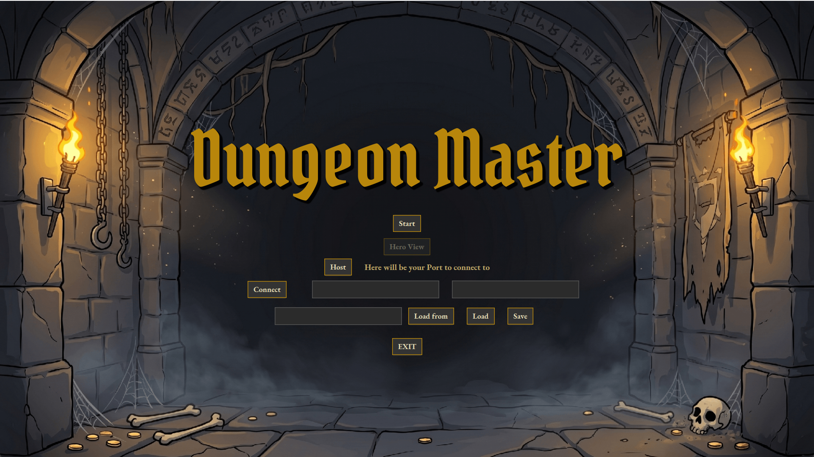
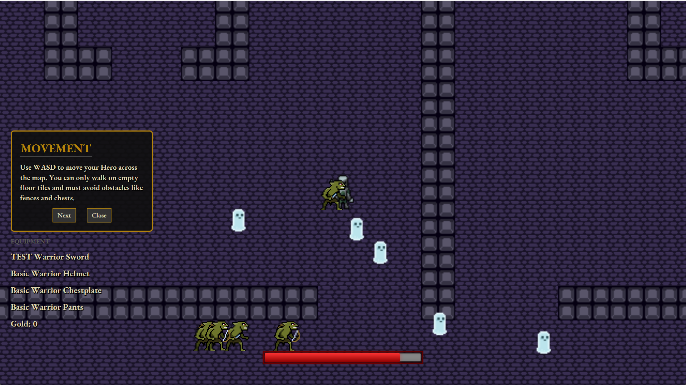

# Dungeon Master

Dungeon Master is a 2D dungeon crawler written in Java and JavaFX as a PJV semestral project. The game combines procedurally generated levels, arena-based combat, loot and equipment, profile persistence, and a client/server foundation for multiplayer-style synchronization.

## Key Features

- **Procedural dungeon generation** - levels are assembled from text-based arena layouts and generated with deterministic seeds.
- **Arena progression** - entering an arena locks the player within the arena, spawns enemy waves, and reopens the grates only after the encounter is cleared.
- **Boss encounters** - regular arenas can spawn stronger enemies, and the final arena ends with a boss fight.
- **Combat system** - the Warrior hero supports movement, melee attacks, defensive/parry-oriented stats, and an ultimate ability charged by consecutive hits.
- **Loot and inventory** - players collect gold, open chests, transfer items, and equip weapons and armor.
- **Profile load/save** - player data is loaded from and saved to JSON using Jackson.
- **Networking layer** - server/client managers and serializable packets support level seeds, entity spawns, entity updates, removals, and player profile synchronization.

## Installation & Setup

### Requirements

- JDK 24
- Maven, or the included Maven wrapper
- JavaFX dependencies are resolved by Maven from `pom.xml`

On Windows:

```powershell
.\mvnw.cmd clean package
```

### Run the Game

The recommended development run command is:

```powershell
java -jar .\target\DungeonMaster-1.0-SNAPSHOT.jar
```
To enable file logging, pass the application argument:

```powershell
java -jar .\target\DungeonMaster-1.0-SNAPSHOT.jar --log=true
```

Logs are written to `logs/game.log`.

## Usage

1. Start the application.
2. Load a player profile:
   - Use `Load` to load the default profile.
   - Use `Load from` with a file path to load a custom profile JSON.
3. Start networking:
   - Use `Host` to start a local server and connect the current client to it. If no host or port is entered, the menu uses `127.0.0.1:5000`.
   - Use `Connect` to connect to an existing host and port.
4. Press `Start` after the profile is loaded and the client is connected.
5. Look through Tutorial to see precise instructions on how to play
6. Play through arenas, defeat mobs and bosses, collect gold, open chests via the gold acquired, and complete the level.


### Controls

- `W`, `A`, `S`, `D` - move 
- Left mouse button - attack toward the mouse cursor
- `E` - activate the ultimate ability
- `F` - interact with nearby chests
- `I` - open the inventory
- Double-click items - transfer items between inventory and chest, or equip gear when no chest is open
## Architecture

For a detailed technical breakdown, see [ARCHITECTURE.md](ARCHITECTURE.md).

The project is organized under `src/main/java/cz/fel/cvut/pjv/dgnmstr`:

- `GameApp` and `DungeonMasterLauncher` - JavaFX application startup, font loading, logging setup, and shutdown cleanup.
- `global` - shared runtime managers for game state, server/client lifecycle, input handling, IDs, image loading, and utility math.
- `view` - JavaFX screens, FXML controllers, scene management, rendering, hero view, tutorial text, and UI resources.
- `dungeon` - generated level model, arenas, entity spawning, tile definitions, difficulty settings, and level/arena state machines.
- `entity` - base entity model, stats, factions, interfaces, heroes, bosses, mobs, projectiles, and map objects.
- `item` - inventory items, weapons, armor, item stats, equipment types, and item registration.
- `player` - player profile, inventory, and persistent player stats.
- `network` - client/server networking managers, packet model, serialization helpers, and payload records for synchronization.

### Runtime Flow

1. `GameApp` initializes JavaFX, loads screens through `SceneManager`, and opens the start menu.
2. The start menu loads a `PlayerProfile`, starts or connects to a server, and asks `ServerManager` to generate a level.
3. `ServerManager` and `LevelController` manage level state, arena progression, entity spawning, and authoritative updates.
4. `ClientManager` collects `Inputs`, sends player actions, receives network packets, and keeps the client-side view synchronized.
5. `GameRenderer` draws the current dungeon, entities, projectiles, items, and UI state.

### Resources

- Arena templates: `src/main/resources/cz/fel/cvut/pjv/dgnmstr/dungeon`
- Sprites and UI assets: `src/main/resources/cz/fel/cvut/pjv/dgnmstr/entity` and `src/main/resources/cz/fel/cvut/pjv/dgnmstr/view`
- Default player profile: `src/main/resources/cz/fel/cvut/pjv/dgnmstr/player/StartPlayer.json`
- Architecture diagrams in docs: `global.png`, `dungeon.png`, `entity.png`, `level-arch.png`, and `server-client-model.png`

## Technologies Used

- Java 24
- JavaFX 21
- Maven
- Jackson Databind
- JUnit 5
- Mockito
- ControlsFX and BootstrapFX

## Authors

- Viktor Panasiuk - game loop, dungeon/arena state, JavaFX structure, hero mechanics, inventory/profile logic, level generation, network communication, JSON.
- Filip Marik - enemy AI, bosses, boss mechanics and encounters, networking records/packages, logging infrastructure, loot drops, crafting mechanics, arena layouts, and Javadoc documentation.

## Resources used for images
- opengameart.org (`src/main/resources/cz/fel/cvut/pjv/dgnmstr/entity/map`)
- itch.io(`src/main/resources/cz/fel/cvut/pjv/dgnmstr/entity/mobs`, `src/main/resources/cz/fel/cvut/pjv/dgnmstr/entity/hero`)
- Filip Marik's Design work(`src/main/resources/cz/fel/cvut/pjv/dgnmstr/entity/boss`, `src/main/resources/cz/fel/cvut/pjv/dgnmstr/entity/projectiles`)
- Gemini generated images(`src/main/resources/cz/fel/cvut/pjv/dgnmstr/view`)
